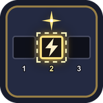
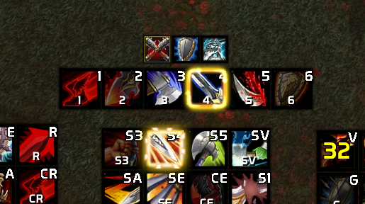

# Skom's Proc Glow (WoW 3.3.5a)

Never miss a proc again. Your action buttons glow the moment a spell is worth pressing, for every class. Works on the Blizzard bars, **Bartender4** and most bar addons, and with macros using `#showtooltip`.

## Features

- **48 rules ready out of the box** for the 10 classes:
  - procs: Sudden Death, Hot Streak, The Art of War, Lock and Load, Maelstrom Weapon, Molten Core and more;
  - execute range: Execute, Drain Soul;
  - rage dumps: Heroic Strike;
  - reactive abilities: Victory Rush, Hammer of Wrath, Kill Shot, Revenge, Overpower.
- **Warrior friendly:** Overpower and Revenge glow in any stance, in another color when you need to swap stance. Heroic Strike stops glowing once queued.
- **Your own rules** for any spell on your bars. They can trigger on:
  - a buff on you;
  - the target's health;
  - your rage, energy or mana;
  - a debuff that is missing or about to fade (for example Mortal Strike).
- **Optional minimum rage per rule,** for example Execute only from 30 rage.
- **Five glow styles** with custom colors per rule, including the WeakAuras styles.
- Glows only while the spell is off cooldown (optional).

## Commands

`/spg` opens the options, `/spg test` previews every glow style on your first bar.

## Feedback

Missing or wrong rule for your spec? Tell me the class, spec and spell:

- **GitHub:** https://github.com/Ahmedrn/SkomsProcGlow/issues
- **Warperia:** comment on the addon page
- **Discord:** `skomzx`
